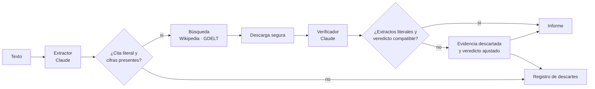

# Veritas-Agent

Pipeline multiagente en Python para apoyar la verificación periodística. Extrae las
afirmaciones comprobables de un texto, las contrasta con fuentes abiertas y genera un
informe con citas literales, enlaces y nivel de confianza.

**Principio de diseño:** el modelo propone y el código comprueba. Si una conclusión no
queda sostenida por extractos localizados en una página descargada, el resultado es
`Sin evidencia suficiente`.

> Prototipo. Apoya la revisión editorial, no la sustituye, y su precisión aún no se ha
> evaluado con una muestra amplia.

## Arquitectura



| Módulo | Responsabilidad |
|---|---|
| [`src/schemas.py`](src/schemas.py) | Contratos Pydantic inmutables y trazabilidad |
| [`src/agents/extractor.py`](src/agents/extractor.py) | Propone afirmaciones y las ancla al texto |
| [`src/agents/verifier.py`](src/agents/verifier.py) | Contrasta afirmaciones y comprueba la evidencia |
| [`src/agents/llm.py`](src/agents/llm.py) | Llamada a Claude con salida estructurada |
| [`src/tools/search.py`](src/tools/search.py) | Búsqueda en Wikipedia y GDELT |
| [`src/tools/fetcher.py`](src/tools/fetcher.py) | Descarga de páginas públicas |
| [`src/tools/resilience.py`](src/tools/resilience.py) | Reintentos, espera exponencial y ritmo de peticiones |
| [`src/orchestrator.py`](src/orchestrator.py) | Flujo, límites y aislamiento de fallos |
| [`src/report.py`](src/report.py) | Informe Markdown, sin modelo de lenguaje |
| [`src/guidance.py`](src/guidance.py) | Causas y acciones para el lector, con textos fijos |
| [`src/costs.py`](src/costs.py) | Estimación de coste |
| [`app.py`](app.py) | Interfaz Streamlit |
| [`evals/`](evals/) | Casos, métricas y ejecutor de la evaluación |

## Garantías y límites

| El código comprueba | El código no puede garantizar |
|---|---|
| La cita de cada afirmación está en el texto auditado | Que la reformulación conserve todos los matices |
| Cada extracto está en la página descargada | Que no esté sacado de contexto |
| Los enlaces de evidencia proceden de páginas descargadas | Que la fuente diga la verdad |
| El veredicto es compatible con la evidencia aceptada | Que Claude la haya clasificado bien |
| La confianza alta exige dos dominios distintos | Que sean editorialmente independientes |
| Las cifras con dígitos tienen respaldo textual | Que correspondan al hecho correcto |

Además:

- **Los fallos son visibles.** Una afirmación no comprobada por límite o avería se
  distingue de una contrastada sin evidencia.
- **Los fallos transitorios se reintentan.** Ante HTTP 429, 5xx, tiempo agotado o red se
  espera de forma exponencial y se respeta `Retry-After`. GDELT se consulta como mucho
  cada 10 segundos y queda en pausa si sigue fallando.
- **El contexto no decide.** Los extractos relacionados son literales, pero nunca
  influyen en el veredicto; su pertinencia la propone el modelo.
- **La evidencia circular se filtra.** Se descartan páginas que reproducen la mitad o
  más del documento. No se detectan paráfrasis ni copias de textos breves.
- **Las fechas no se infieren.** Solo se usa la publicación declarada por la página.
- **El contenido externo no es de confianza.** Se bloquean direcciones internas, se
  limita el tamaño y se neutraliza el formato de los textos citados. Los prompts piden
  ignorar instrucciones de los documentos, aunque eso no elimina el riesgo de inyección.

## Instalación

Requiere Python 3.11 o superior (probado en 3.12) y una clave de la API de Anthropic.

```bash
python3 -m venv .venv
```

```bash
.venv/bin/pip install -r requirements.txt
```

```bash
cp .env.example .env
```

Escribe la clave en `.env`, excluido de git. Después:

```bash
.venv/bin/streamlit run app.py
```

Desde Python, con la variable `ANTHROPIC_API_KEY` definida:

```python
from src.orchestrator import AuditLimits, build_pipeline
from src.report import render_markdown

pipeline = build_pipeline("es", AuditLimits(max_claims=3, max_sources=2))
result = pipeline.run("La Torre Eiffel se inauguró en 1889.")
print(render_markdown(result))
```

## Ejemplo real

Ejecución del 24 de noviembre de 2026 con Claude Opus 5.5, sobre un texto preparado con
resultados conocidos. La cuarta frase era una opinión y no se extrajo.

| Afirmación | Veredicto | Confianza | Extracto |
|---|---|---|---|
| La Torre Eiffel se inauguró en 1889. | Confirmada | media | «Construida en dos años, dos meses y cinco días (de 1887 a 1889) por 250 obreros, se inauguró oficialmente el 31 de marzo de 1889.» [Wikipedia](https://es.wikipedia.org/wiki/Torre_Eiffel) |
| El río Amazonas desemboca en el océano Pacífico. | Refutada | media | «El río entra en el océano Atlántico en un amplio estuario de 240 km de ancho.» [Wikipedia](https://es.wikipedia.org/wiki/R%C3%ADo_Amazonas) |
| El panadero Aurelio Quintanilla Bermejo vendió 412 panes el 3 de marzo de 2019. (nombre inventado para la prueba) | Sin evidencia suficiente | — | — |

La ejecución usó 134.010 tokens de entrada y 1.457 de salida: unos 0,57 USD calculados
con la tarifa de entonces. GDELT rechazó dos de las tres búsquedas (HTTP 429). **Son
tres casos sencillos: demuestran que el flujo funciona, no su precisión.**

## Pruebas

```bash
.venv/bin/python -m pytest
```

Las pruebas unitarias no usan la red ni consumen saldo: simulan las respuestas HTTP y
los componentes. La prueba real es aparte y **consume saldo**; guarda sus resultados en
`outputs/`:

```bash
.venv/bin/python -m scripts.live_check
```

## Evaluación

**Preparada, todavía no ejecutada: no hay cifras de precisión.** Son 26 casos en
[`evals/cases.json`](evals/cases.json): 8 ciertos, 7 falsos, 3 engañosos, 3
desactualizados y 5 no comprobables. Los 21 concluyentes llevan una referencia ajena a
Wikipedia, que el pipeline no recibe; el 24 de noviembre de 2026 todos los extractos
estaban en su página.

Comprobar las referencias (usa la red, sin coste de API):

```bash
.venv/bin/python -m evals.check_references
```

Ver la estimación de coste, sin llamar a la API:

```bash
.venv/bin/python -m evals.run
```

Ejecutarla, con un tope de gasto:

```bash
.venv/bin/python -m evals.run --run --max-usd 8
```

Se distinguen los errores (afirmar algo concluyente e incorrecto) de las abstenciones.
La muestra es pequeña y sobre todo enciclopédica, no incluye casos `En disputa` ni
artículos largos, y los nombres de los casos no comprobables son inventados.

## Privacidad y coste

El texto auditado se envía a Anthropic, y las palabras clave a Wikipedia y GDELT. Las
páginas candidatas reciben peticiones desde tu equipo. No uses material confidencial o
embargado.

La interfaz muestra una estimación alta antes de ejecutar, que no es un tope. Las
peticiones usan el modelo de respaldo automático de la API si los filtros de seguridad
rechazan un texto, lo que puede cambiar el coste.

## Pendiente

- Ejecutar la evaluación y ampliarla con noticias de actualidad, citas fuera de contexto
  y casos en disputa.
- Una fuente de noticias más estable: GDELT es intermitente y Wikipedia, secundaria.
- Lectura de PDF y Word; hoy solo se admite texto pegado.
- Selección de pasajes para reducir el coste.
- Respeto de `robots.txt` y ritmo de descarga antes de un uso intensivo.

## Licencia

Código bajo [licencia MIT](LICENSE). Los extractos citados en el ejemplo y en la
evaluación pertenecen a sus fuentes y conservan sus propias condiciones.
